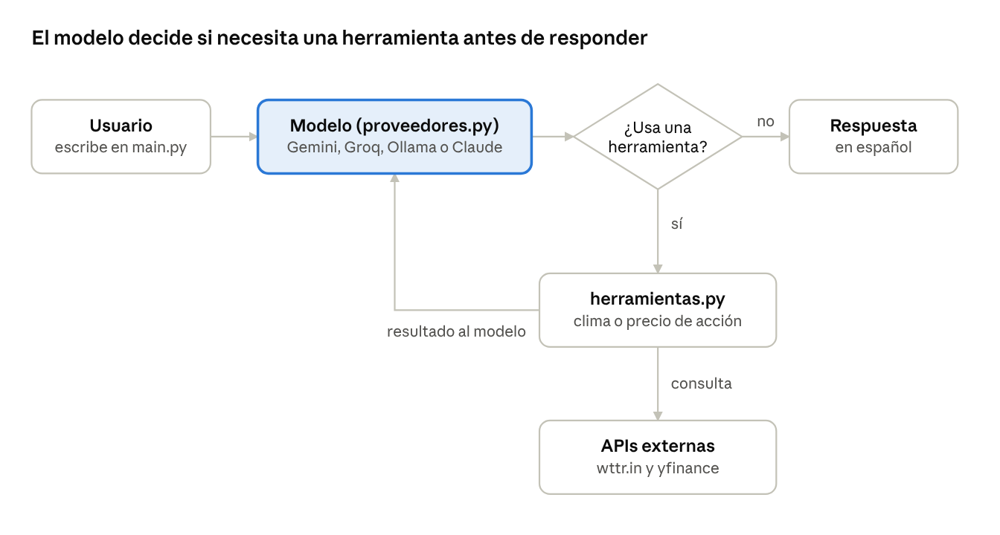

# Asistente personal con IA

[](https://github.com/krma12/asistente-personal/actions/workflows/ci.yml)

🌐 [English](README.md) · **Español**

Asistente de consola en Python que usa un LLM con *tool use* para responder con datos en tiempo real. Ya ofrece **noticias personalizadas** (ciberseguridad, IA, tecnología, geopolítica) y **vulnerabilidades explotadas activamente** (CISA KEV). La meta es un asistente diario disponible desde Telegram, con recordatorios del calendario y **vacantes de empleo** alineadas con un perfil profesional.

> Proyecto en desarrollo. Nació a partir de un ejercicio de clase de chatbots
> ([automatizaci-n_simple](https://github.com/krma12/automatizaci-n_simple)) y evoluciona aquí como proyecto independiente.



## Cómo funciona

1. El usuario escribe una pregunta en lenguaje natural.
2. El modelo decide si necesita una herramienta: clima, acciones, fecha y hora, noticias por tema o vulnerabilidades explotadas.
3. Python ejecuta la herramienta y le devuelve el resultado al modelo.
4. El modelo redacta la respuesta final en español, sin inventar datos.

## Proveedores de IA intercambiables

Se elige el modelo con una línea en `.env`, sin tocar el código:

| `LLM_PROVIDER` | Costo | Notas |
| --- | --- | --- |
| `gemini` | Gratis con límites | Clave en Google AI Studio |
| `groq` | Gratis con límites | Modelos abiertos, muy rápido |
| `ollama` | Gratis, local | Los datos no salen de tu computadora |
| `claude` | De pago | API de Anthropic |

`proveedores.py` tiene dos adaptadores: uno para la API nativa de Anthropic y otro para las API compatibles con OpenAI (Gemini, Groq, Ollama).

## Hoja de ruta

- [x] **Fase 1:** LLM con *tool use*, multi-proveedor, herramientas de clima, acciones y hora, pruebas con `pytest`
- [x] **Fase 2:** noticias por tema desde fuentes RSS, personalizadas con el perfil local, más vulnerabilidades de CISA KEV, con defensas contra inyección de prompts
- [ ] **Fase 3:** bot de Telegram: conversar desde el celular y una pregunta cada mañana para recibir las noticias
- [ ] **Fase 4:** recordatorios de Google Calendar con días de anticipación y recordatorios creados por mensaje
- [ ] **Fase 5:** vacantes leídas desde alertas de empleo por correo y calificadas contra el perfil local (Iberoamérica, incluido Brasil)

Detalle de errores encontrados, correcciones y decisiones: [Reporte de progreso](docs/REPORTE_PROGRESO.md).

## Decisiones de diseño y seguridad

- **Defensas contra inyección de prompts (OWASP LLM01):** el texto de noticias y CVE se trata como datos no confiables. Se le quita el HTML y los caracteres de control, se recorta, se envuelve en delimitadores que el texto externo no puede falsificar y se revisa en busca de frases típicas de inyección, que se le señalan al usuario. Las pruebas simulan ataques reales.
- **Mínimo privilegio:** todas las herramientas son de solo lectura, y el modelo solo elige un tema de una lista fija, nunca una URL (evita SSRF). Cualquier parámetro que no esté declarado en la ficha de una herramienta se rechaza.
- **Descargas seguras:** límite de tiempo y de tamaño en cada petición; una fuente caída nunca tumba a las demás.
- **Minimización de datos:** de `perfil.yaml` solo se envían al modelo los intereses y el objetivo profesional, cargados con `yaml.safe_load`.
- **Sin scraping de LinkedIn ni Indeed:** sus términos de uso lo prohíben. Las vacantes se obtendrán de las alertas de empleo que esas plataformas envían por correo al propio usuario.
- **Datos personales fuera del repositorio:** el perfil real (`perfil.yaml`), las claves (`.env`) y las salidas generadas están en `.gitignore`. El repo solo incluye plantillas con datos ficticios.
- **Privacidad por proveedor:** para analizar el perfil personal se recomienda Ollama (local), porque los niveles gratuitos de algunas API pueden usar los datos enviados para mejorar sus productos.
- **Integración continua con revisiones de seguridad:** cada push corre las pruebas en Python 3.12 y 3.13, un análisis estático de seguridad con Bandit y una revisión de vulnerabilidades en dependencias con pip-audit. Dependabot propone actualizaciones semanales de librerías y de GitHub Actions.
- **Compatibilidad real entre proveedores:** Gemini 3 exige recibir de vuelta una firma de razonamiento en cada llamada a herramienta. El adaptador conserva todos los campos de la respuesta en lugar de reconstruir los mensajes.

## Instalación (Windows / PowerShell)

```powershell
python -m venv .bot
.\.bot\Scripts\Activate.ps1
pip install -r requirements.txt
copy .env.example .env          # elige LLM_PROVIDER y pon su clave
copy perfil.example.yaml perfil.yaml   # (para la Fase 3) tus datos reales
python main.py
```

## Pruebas

```powershell
python -m pytest -v
```

Las pruebas usan simulaciones (*mocks*): no necesitan internet ni gastan créditos de API.

## Estructura

```
asistente-personal/
├── main.py                 # Conversación por consola
├── proveedores.py          # Adaptadores de LLM + selección por .env
├── herramientas.py         # Registro de herramientas (fichas JSON Schema)
├── funciones_agente/       # Una habilidad por archivo
│   ├── obtener_clima.py
│   ├── obtener_precio_accion.py
│   ├── obtener_hora.py
│   ├── obtener_noticias.py          # RSS por tema (lista blanca fija)
│   ├── obtener_vulnerabilidades.py  # CISA KEV
│   └── contenido_externo.py         # Manejo seguro de contenido no confiable
├── perfil.py               # Lee los intereses de perfil.yaml
├── test_asistente.py
├── test_noticias.py        # Incluye ataques de inyección simulados
├── .env.example            # Plantilla de claves (sin datos reales)
├── perfil.example.yaml     # Plantilla de perfil (datos ficticios)
├── README.md               # Versión en inglés
└── docs/
    ├── REPORTE_PROGRESO.md # Reporte de progreso (español)
    ├── PROGRESS_REPORT.md  # Reporte de progreso (inglés)
    └── flujo_tool_use.png
```

## Créditos

Este proyecto parte de [automatizaci-n_simple](https://github.com/mendiolaleonel2002-debug/automatizaci-n_simple) de mendiolaleonel2002-debug, el repositorio base de un ejercicio de la clase de IA. Primero se hizo fork en [krma12/automatizaci-n_simple](https://github.com/krma12/automatizaci-n_simple), donde se construyó y entregó la v2.0.

- **Se conservó del original:** la estructura de una habilidad por archivo en `funciones_agente/` y el uso de wttr.in y yfinance.
- **Se reescribió:** las funciones de clima y acciones, `main.py` y las pruebas.
- **Es nuevo:** `proveedores.py`, `herramientas.py`, el soporte multi-proveedor y la configuración con `.env`.
