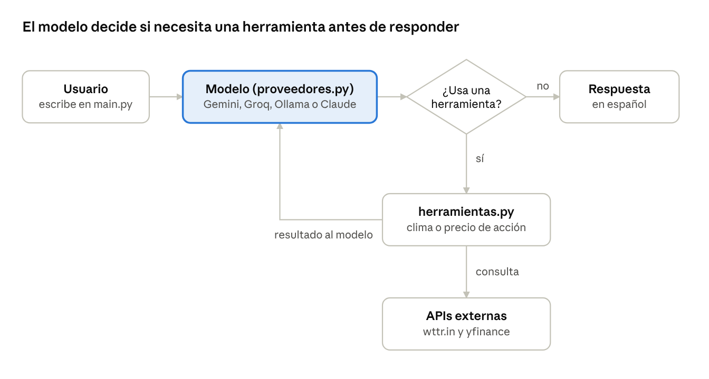

# AI Personal Assistant

[](https://github.com/krma12/asistente-personal/actions/workflows/ci.yml)

🌐 **English** · [Español](README.es.md)

A Python console assistant that uses an LLM with *tool use* to answer with real-time data. It already delivers **personalized news** (cybersecurity, AI, technology, geopolitics) and **actively exploited vulnerabilities** (CISA KEV). It runs as a **private Telegram bot** that asks every morning whether you want your daily briefing (agenda + news), reads your **Google Calendar**, and creates reminders **only after you confirm them**. Next: **job openings** matched to a professional profile.

> Work in progress. It started from a chatbot class exercise
> ([automatizaci-n_simple](https://github.com/krma12/automatizaci-n_simple)) and continues here as an independent project.



## How it works

1. The user asks a question in natural language.
2. The model decides whether it needs a tool: weather, stocks, date and time, news by topic, exploited vulnerabilities, calendar agenda, or a reminder proposal.
3. Python runs the tool and sends the result back to the model.
4. The model writes the final answer in Spanish without making up data.

## Swappable AI providers

Pick the model with one line in `.env`, no code changes:

| `LLM_PROVIDER` | Cost | Notes |
| --- | --- | --- |
| `gemini` | Free with limits | Key from Google AI Studio |
| `groq` | Free with limits | Open models, very fast |
| `ollama` | Free, local | Data never leaves your computer |
| `claude` | Paid | Anthropic API |

`proveedores.py` has two adapters: one for Anthropic's native API and one for OpenAI-compatible APIs (Gemini, Groq, Ollama).

## Roadmap

- [x] **Phase 1:** LLM with *tool use*, multi-provider, weather, stock, and time tools, `pytest` tests
- [x] **Phase 2:** news from RSS feeds by topic, personalized with the local profile, plus CISA KEV vulnerabilities, with prompt-injection defenses
- [x] **Phase 3:** private Telegram bot: chat from the phone and a morning prompt with a button for the daily news
- [x] **Phase 4:** Google Calendar agenda in the daily briefing, and reminders created by message with notifications days in advance, always confirmed by the user
- [ ] **Phase 5:** job openings read from email job alerts and scored against the local profile (Ibero-America, including Brazil)

Full details on bugs found, fixes, and decisions: [Progress report](docs/PROGRESS_REPORT.md).

## Design and security decisions

- **Prompt-injection defenses (OWASP LLM01):** news and CVE text is treated as untrusted data. It is stripped of HTML and control characters, truncated, wrapped in delimiters that external text cannot forge, and scanned for typical injection phrases, which are flagged to the user. Tests simulate real attacks.
- **Private Telegram bot:** it only answers the chat ID set in `.env`; anyone else is ignored and only their ID is logged, never their message. The token is never printed (httpx request logging, which includes the token in the URL, is silenced).
- **Human in the loop for writes:** creating a calendar event is the only write action, and the model can only *propose* it. Nothing is created until the user taps **Create** in Telegram (or types `s` in the console); there is deliberately no tool for the model to confirm. An injected instruction in a news item or a calendar invitation cannot create events on its own.
- **Minimal Google scope:** only `calendar.events` (no Gmail, Drive or account settings). OAuth credentials and tokens live in `secretos/`, excluded from Git. Event titles are treated as untrusted content, since anyone can send you an invitation.
- **Least privilege:** every tool is read-only, and the model only picks a topic from a fixed list, never a URL (prevents SSRF). Any parameter not declared in a tool's schema is rejected.
- **Safe downloads:** time and size limits on every request; one broken source never breaks the others.
- **Data minimization:** only interests and career goal from `perfil.yaml` are sent to the model, loaded with `yaml.safe_load`.
- **No LinkedIn or Indeed scraping:** their terms of use prohibit it. Job openings will come from the job alerts those platforms email to the user.
- **Personal data stays out of the repository:** the real profile (`perfil.yaml`), API keys (`.env`) and generated output are in `.gitignore`. The repo only ships templates with fictional data.
- **Privacy per provider:** Ollama (local) is recommended for analyzing the personal profile, because some APIs' free tiers may use submitted data to improve their products.
- **Continuous integration with security checks:** every push runs the tests on Python 3.12 and 3.13, a static security scan with Bandit, and a dependency vulnerability check with pip-audit. Dependabot proposes weekly updates for libraries and GitHub Actions.
- **Real-world provider compatibility:** Gemini 3 requires a reasoning signature to be sent back with every tool call. The adapter keeps every field of the response instead of rebuilding messages by hand.

## Setup (Windows / PowerShell)

Requires **Python 3.12 or newer** (3.13 recommended). Dependency versions are pinned in `requirements.txt` and kept up to date by Dependabot.

```powershell
py -3.13 -m venv .bot
.\.bot\Scripts\Activate.ps1
python -m pip install --upgrade pip
pip install -r requirements.txt
copy .env.example .env          # choose LLM_PROVIDER and add its key
copy perfil.example.yaml perfil.yaml   # your real data (personalizes the news)
python main.py
```

### Google Calendar

1. In [Google Cloud Console](https://console.cloud.google.com/), create a project and enable the **Google Calendar API**.
2. Configure the **OAuth consent screen** (External) and add your own Google account as a test user.
3. Create an **OAuth client ID** of type **Desktop app**, download the JSON and save it as `secretos/google_credentials.json`.
4. Run `python configurar_calendario.py` once: it opens the browser to authorize access and saves `secretos/google_token.json`.
5. While the consent screen is in **Testing**, Google expires the authorization every 7 days. To avoid re-authorizing weekly, switch the publishing status to **In production** (Google will show an "unverified app" warning, which is expected for a personal app) and run step 4 again.

### Telegram

1. Create a bot with **@BotFather** and add `TELEGRAM_BOT_TOKEN` to `.env`.
2. Run `python bot_telegram.py` and send `/start` to your bot: it replies with your chat ID.
3. Add `TELEGRAM_CHAT_ID` to `.env` and restart the bot. From then on it only answers you.
4. Optional: `HORA_RESUMEN` (default `08:00`) and `ZONA_HORARIA` (default `America/Mexico_City`).

The bot runs while `bot_telegram.py` is running on your computer.

## Tests

```powershell
python -m pytest -v
```

Tests use mocks: no internet connection or API credits needed.

## Structure

```
asistente-personal/
├── main.py                 # Console conversation
├── proveedores.py          # LLM adapters + provider selection via .env
├── herramientas.py         # Tool registry (JSON Schema definitions)
├── funciones_agente/       # One skill per file
│   ├── obtener_clima.py
│   ├── obtener_precio_accion.py
│   ├── obtener_hora.py
│   ├── obtener_noticias.py          # RSS by topic (fixed allowlist)
│   ├── obtener_vulnerabilidades.py  # CISA KEV
│   ├── calendario.py                # Agenda + reminders with user confirmation
│   └── contenido_externo.py         # Safe handling of untrusted content
├── perfil.py               # Reads interests from perfil.yaml
├── bot_telegram.py         # Private Telegram bot
├── configurar_calendario.py # One-time Google Calendar authorization
├── test_asistente.py
├── test_noticias.py        # Includes simulated injection attacks
├── test_telegram.py        # Allowlist and bot behavior
├── test_calendario.py      # Reminders only created after confirmation
├── .env.example            # API key template (no real data)
├── perfil.example.yaml     # Profile template (fictional data)
├── README.es.md            # Spanish version
└── docs/
    ├── PROGRESS_REPORT.md  # Progress report (English)
    ├── REPORTE_PROGRESO.md # Progress report (Spanish)
    └── flujo_tool_use.png
```

## Credits

This project is based on [automatizaci-n_simple](https://github.com/mendiolaleonel2002-debug/automatizaci-n_simple) by mendiolaleonel2002-debug, the starter repository for an AI class exercise. It was first forked to [krma12/automatizaci-n_simple](https://github.com/krma12/automatizaci-n_simple), where v2.0 was built and submitted.

- **Kept from the original:** the one-skill-per-file structure in `funciones_agente/`, and the use of wttr.in and yfinance.
- **Rewritten:** the weather and stock functions, `main.py`, and the tests.
- **New:** `proveedores.py`, `herramientas.py`, multi-provider support, and `.env` configuration.
