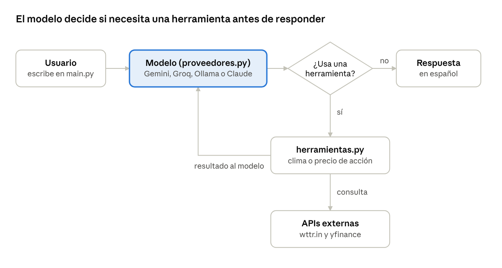

# Progress Report — Chatbot v2.0

🌐 **English** · [Español](REPORTE_PROGRESO.md)

November 4, 2026 · Hugo Maldonado Caballero

## Summary

The chatbot moved from recognizing phrases with regular expressions to using a language model with *tool use*, and it now answers through Gemini (free tier) from VS Code. Four bugs in the original code were fixed, support for 4 AI providers was added, and test coverage went from 1 test with no assertions to 18 automated tests.

- **Class goal:** fork the `automatizaci-n_simple` repository and build a chatbot from it.
- **Personal goal:** turn it into a daily assistant for news (technology, cybersecurity, geopolitics) and for job openings matched to a professional profile.
- **Status as of November 4, 2026:** Phase 1 implemented. Gemini answers general questions and uses the weather and stock tools; the 400 error was fixed and confirmed. Phase 1 was submitted in the class fork, and work continues in this repository, `asistente-personal`.

## Code origin

This project starts from the repository [mendiolaleonel2002-debug/automatizaci-n_simple](https://github.com/mendiolaleonel2002-debug/automatizaci-n_simple), provided as an exercise in the AI class. It was forked to [krma12/automatizaci-n_simple](https://github.com/krma12/automatizaci-n_simple), where v2.0 was developed and submitted. The working code was then copied to this repository to keep growing as a personal project.

- **Kept from the original:** the one-skill-per-file idea in `funciones_agente/`, and the use of wttr.in (weather) and yfinance (stocks).
- **Rewritten:** both functions, `main.py`, and the tests.
- **New:** `proveedores.py`, `herramientas.py`, multi-provider support, and `.env` configuration.

## Original project (v1.0)

The instructor's repository is a Python console chatbot of about 550 lines with two skills: checking the weather and stock prices. It did not use AI: it detected intent by searching for keywords.

| Component | Role in v1.0 |
| --- | --- |
| `main.py` | Console chatbot; detects intent with regular expressions (regex) |
| `agente_selenium.py` | Second version that opens headless Chrome with Selenium and detects keywords |
| `funciones_agente/obtener_clima.py` | Gets the temperature from the free wttr.in API |
| `funciones_agente/obtener_precio_accion.py` | Gets the price with the yfinance library; has a dictionary of 11 company names to tickers |
| `utils/sanitizar.py` | Strips prefixes like "precio de" or "la" to isolate the company name |
| `test_chatbot.py` | Prints Microsoft's price; does not check any result |
| `prueba_selenium.py` | Opens Google, Hybridge, and OpenAI in Chrome as a demo |

**What was already well done and was kept:**

- **Modularity:** each skill lives in its own file inside `funciones_agente/`.
- **Interface separation:** the same function can be called from the console or from Selenium.
- **Error handling:** `try/except` in the main loop and in API calls, with a clean exit on Ctrl+C.
- **Documentation:** README with a Mermaid architecture diagram and a list of suggested improvements. The first suggestion was precisely to replace the regex with an LLM.

## Bugs found in the original code

When the text cleanup was tested with real questions, none of the 4 sample questions reached the API correctly. The two most serious bugs broke even the example the bot itself shows at startup.

| Test question | Text sent to the API | Cause |
| --- | --- | --- |
| clima en Denver | `dver` | `obtener_clima` deleted "en" and "de" anywhere inside a word, not only as standalone words |
| temperatura en Benito Juárez | `bito juárez` | The same `.replace("en", "")` |
| ¿cuál es la temperatura actual en la Ciudad de México? | `¿cuál es la  actual  la ciudad  méxico?` | Only keywords were removed; the rest of the sentence was sent as is |
| ¿cuál es el precio de una acción de Microsoft? | the whole sentence as the ticker | `main.py` did not clean the text, and `sanitizar` only strips leading prefixes |

**Other issues:**

1. **Unused Selenium:** `agente_selenium.py` opened Chrome and passed the browser to the functions, but none of them used it. It only slowed down startup.
2. **Junk files in the repository:** `__pycache__` folders were committed even though `.gitignore` excluded them.
3. **Tests without assertions:** `test_chatbot.py` only printed a result; it never checked whether it was correct.
4. **Empty price on weekends:** requesting 1 day of history from yfinance may return no data when the market is closed.

## Improvements and optimizations (v2.0)

The core change was replacing the regex with a language model using *tool use*: the model understands the question, decides which tool to use, extracts the clean parameter, and writes the answer. The weather and stock functions were kept and turned into tools.

| Area | v1.0 | v2.0 |
| --- | --- | --- |
| Understanding | Regex and keywords | LLM with *tool use* |
| AI providers | None | Gemini, Groq, Ollama, and Claude, selected with `LLM_PROVIDER` in `.env` |
| Conversation memory | No | Yes, trimmed to the 20 most recent messages |
| Weather | Temperature only; city names mangled | Condition, temperature, feels-like, and humidity in Spanish; city kept intact and URL-encoded |
| Stocks | 1-day price; 11 names in the dictionary | 5-day history, with currency and closing date; the model converts any company to its ticker |
| Tests | 1 script with no assertions | 18 `pytest` tests with mocks, no internet or cost |
| Security | No key handling | Keys in `.env` excluded from Git, `.env.example` template |
| Errors | Generic message | Shows the server's detail and rolls the failed question back out of the history |

**New or rewritten files:**

- **`herramientas.py` (new):** central tool registry. Each tool has a definition (name, description, and JSON Schema parameters) and its Python function. Adding a skill means adding a definition.
- **`proveedores.py` (new):** two adapters, one for Anthropic's native API and one for OpenAI-compatible APIs (Gemini, Groq, Ollama), plus a function that picks the provider from `.env`.
- **`main.py` (rewritten):** only handles the conversation; it does not depend on which model is behind it.
- **`agente_selenium.py` (adjusted):** still works with the new function signatures, in case it is used later in the class.
- **`README.md` (updated):** v2.0 changes section, provider table, and usage instructions.

## Problems during implementation

Four problems came up while installing and testing on Windows; all 4 were resolved and no key reached GitHub.

| Problem | Cause | Solution |
| --- | --- | --- |
| Gemini 400 error when using a tool | Gemini 3 sends a hidden "reasoning signature" with each tool call and requires it back; the code rebuilt the message and dropped it | Store the model's response exactly as received (`model_dump`), with a test confirming the signature is kept |
| API key shared in a chat | The key was pasted into a conversation | Treated as exposed: deleted in Google AI Studio and a new one generated |
| Key inside `.env.example` | The key was pasted into the template, which does get pushed to GitHub | Detected by the file size (728 to 769 bytes) and the template was restored before the first commit |
| `.Bot` virtual environment not excluded | `.gitignore` only covered names like `.venv` and `venv` | Added `.bot/` to `.gitignore`, along with the `cheetsheet` notes file |

**Main lesson:** even though Gemini, Groq, and Ollama claim to be "OpenAI-compatible", each provider has its own details. An adapter that keeps fields it does not recognize is more robust than one that rebuilds messages by hand.

## Current features and v2.0 structure

v2.0 answers in Spanish, remembers the conversation, uses tools only when the question requires it, and never makes up temperatures or prices.



If the model requests a tool, Python runs it and returns the result; the loop repeats up to 5 times before answering.

**File structure (class fork):**

```
automatizaci-n_simple/
├── main.py               # Console conversation
├── proveedores.py        # LLM adapters + selection via .env  (new)
├── herramientas.py       # Tool definitions and registry       (new)
├── funciones_agente/
│   ├── obtener_clima.py
│   └── obtener_precio_accion.py
├── utils/sanitizar.py    # No longer used by main.py; used by agente_selenium.py
├── agente_selenium.py
├── test_chatbot.py       # 18 pytest tests
├── REPORTE_PROGRESO.md   # This report
├── docs/flujo_tool_use.png  # Flow diagram
├── .env.example          # Public template (no keys)
├── .env                  # Real keys (excluded from Git)
└── requirements.txt
```

**Available providers:**

| Provider | Cost | Default model | Recommended use |
| --- | --- | --- | --- |
| Gemini | Free with limits | `gemini-3.5-flash` | Daily testing (active today) |
| Groq | Free with limits | `openai/gpt-oss-20b` | Fast alternative |
| Ollama | Free, local | `qwen3:4b` | Personal data (Phase 3), for privacy |
| Claude | Paid | `claude-haiku-5-5` | Production |

**Environment:** Windows, VS Code, project on an external SSD (`D:\Proyectos`), `.Bot` virtual environment.

## Next steps

Phase 1 is submitted; Phases 2 to 4 are developed in this public repository, with no personal data, as a portfolio project.

- [x] Confirm the 400 error fix works with weather and stocks (confirmed November 4)
- [x] Run `python -m pytest -v` and verify 18 green tests
- [x] Check with `git status` that `.env`, `.Bot`, and `cheetsheet` don't show up; commit and push to the fork
- [ ] **Phase 2, news:** `obtener_noticias` tool with RSS feeds for technology, cybersecurity, AI, and geopolitics
- [ ] **Phase 3, job openings:** read LinkedIn and Indeed job alerts from Gmail (no scraping) and score them against a local `perfil.yaml`; coverage across Ibero-America, including Brazil, with a realistic Portuguese level
- [ ] **Phase 4, daily use:** automatic morning briefing
- [x] Create the new public repository (`asistente-personal`) with `.gitignore` and example templates from the first commit
