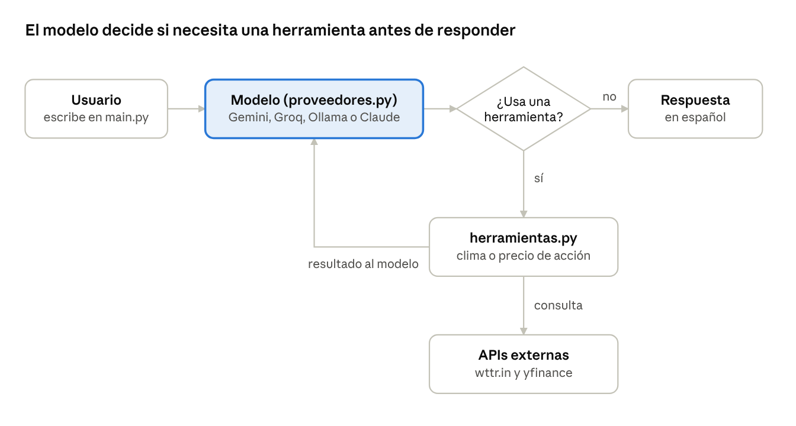

# Reporte de progreso — Chatbot v2.0

🌐 [English](PROGRESS_REPORT.md) · **Español**

4 de noviembre de 2026 · Hugo Maldonado Caballero

## Resumen

El chatbot pasó de reconocer frases con expresiones regulares a usar un modelo de lenguaje con *tool use*, y ya responde con Gemini (gratis) desde VS Code. Se corrigieron 4 errores del código original, se agregó soporte para 4 proveedores de IA y la cobertura de pruebas pasó de 1 prueba sin verificaciones a 18 pruebas automáticas.

- **Objetivo de la clase:** hacer fork del repositorio `automatizaci-n_simple` y construir un chatbot a partir de él.
- **Objetivo personal:** convertirlo después en un asistente diario de noticias (tecnología, ciberseguridad, geopolítica) y de vacantes alineadas con el perfil profesional.
- **Estado al 4 de noviembre de 2026:** Fase 1 implementada en `D:\Proyectos\automatizaci-n_simple`. Gemini ya responde preguntas generales y usa las herramientas de clima y acciones; el error 400 quedó corregido y confirmado. La Fase 1 se entregó en el fork de la clase y el trabajo continúa en este repositorio, `asistente-personal`.

## Origen del código

Este proyecto parte del repositorio [mendiolaleonel2002-debug/automatizaci-n_simple](https://github.com/mendiolaleonel2002-debug/automatizaci-n_simple), proporcionado como ejercicio en la clase de IA. Se hizo fork en [krma12/automatizaci-n_simple](https://github.com/krma12/automatizaci-n_simple), donde se desarrolló y entregó la v2.0. Después, el código que ya funcionaba se copió a este repositorio para seguir creciendo como proyecto personal.

- **Se conservó del original:** la idea de una habilidad por archivo en `funciones_agente/` y el uso de wttr.in (clima) y yfinance (acciones).
- **Se reescribió:** las dos funciones, `main.py` y las pruebas.
- **Es nuevo:** `proveedores.py`, `herramientas.py`, el soporte multi-proveedor y la configuración con `.env`.

## Proyecto original (v1.0)

El repositorio del profesor es un chatbot de consola en Python de unas 550 líneas con dos habilidades: consultar el clima y el precio de acciones. No usaba IA: detectaba la intención buscando palabras clave.

| Componente | Función en v1.0 |
| --- | --- |
| `main.py` | Chatbot de consola; detecta la intención con expresiones regulares (regex) |
| `agente_selenium.py` | Segunda versión que abre Chrome sin ventana (headless) con Selenium y detecta palabras clave |
| `funciones_agente/obtener_clima.py` | Consulta la temperatura en la API gratuita wttr.in |
| `funciones_agente/obtener_precio_accion.py` | Consulta el precio con la librería yfinance; tiene un diccionario de 11 nombres de empresa a ticker |
| `utils/sanitizar.py` | Quita prefijos como "precio de" o "la" para aislar el nombre de la empresa |
| `test_chatbot.py` | Imprime el precio de Microsoft; no verifica ningún resultado |
| `prueba_selenium.py` | Abre Google, Hybridge y OpenAI en Chrome como demostración |

**Lo que ya estaba bien hecho y se conservó:**

- **Modularidad:** cada habilidad vive en su propio archivo dentro de `funciones_agente/`.
- **Separación de la interfaz:** la misma función se puede llamar desde la consola o desde Selenium.
- **Manejo de errores:** `try/except` en el ciclo principal y en las llamadas a las API, con salida limpia usando Ctrl+C.
- **Documentación:** README con diagrama de arquitectura en Mermaid y una lista de mejoras sugeridas. La primera sugerencia era justamente reemplazar los regex por un LLM.

## Errores encontrados en el código original

Al probar la limpieza de texto con preguntas reales, ninguna de las 4 preguntas de ejemplo llegó correcta a la API. Los dos errores más graves hacían fallar incluso el ejemplo que el propio bot muestra al arrancar.

| Pregunta de prueba | Texto que llegaba a la API | Causa |
| --- | --- | --- |
| clima en Denver | `dver` | `obtener_clima` borraba "en" y "de" en cualquier parte de la palabra, no solo como palabras sueltas |
| temperatura en Benito Juárez | `bito juárez` | El mismo `.replace("en", "")` |
| ¿cuál es la temperatura actual en la Ciudad de México? | `¿cuál es la  actual  la ciudad  méxico?` | Solo se borraban palabras clave; el resto de la frase se enviaba completo |
| ¿cuál es el precio de una acción de Microsoft? | la frase completa como ticker | `main.py` no limpiaba el texto y `sanitizar` solo quita prefijos al inicio |

**Otros problemas:**

1. **Selenium sin uso:** `agente_selenium.py` abría Chrome y pasaba el navegador a las funciones, pero ninguna lo usaba. Solo hacía más lento el arranque.
2. **Archivos basura en el repositorio:** se subieron carpetas `__pycache__` aunque el `.gitignore` las excluía.
3. **Pruebas sin verificación:** `test_chatbot.py` solo imprimía un resultado; nunca comprobaba si era correcto.
4. **Precio vacío en fines de semana:** pedir 1 día de historial a yfinance puede no devolver datos cuando el mercado está cerrado.

## Mejoras y optimizaciones (v2.0)

El cambio central fue sustituir los regex por un modelo de lenguaje con *tool use*: el modelo entiende la pregunta, decide qué herramienta usar, extrae el parámetro limpio y redacta la respuesta. Las funciones de clima y acciones se conservaron y se convirtieron en herramientas.

| Área | v1.0 | v2.0 |
| --- | --- | --- |
| Comprensión | Regex y palabras clave | LLM con *tool use* |
| Proveedores de IA | Ninguno | Gemini, Groq, Ollama y Claude, elegibles con `LLM_PROVIDER` en `.env` |
| Memoria de la conversación | No | Sí, recortada a los 20 mensajes más recientes |
| Clima | Solo temperatura; nombres de ciudad alterados | Condición, temperatura, sensación térmica y humedad en español; ciudad intacta y codificada en la URL |
| Acciones | Precio de 1 día; 11 nombres en el diccionario | Historial de 5 días, con moneda y fecha de cierre; el modelo convierte cualquier empresa a su ticker |
| Pruebas | 1 script sin verificaciones | 18 pruebas con `pytest` y simulaciones (*mocks*), sin internet ni costo |
| Seguridad | Sin manejo de claves | Claves en `.env` excluido de Git, plantilla `.env.example` |
| Errores | Mensaje genérico | Muestra el detalle del servidor y deshace la pregunta fallida del historial |

**Archivos nuevos o reescritos:**

- **`herramientas.py` (nuevo):** registro central de herramientas. Cada una tiene una ficha (nombre, descripción y parámetros en JSON Schema) y su función de Python. Agregar una habilidad nueva es agregar una ficha.
- **`proveedores.py` (nuevo):** dos adaptadores, uno para la API nativa de Anthropic y otro para las API compatibles con OpenAI (Gemini, Groq, Ollama), más una función que elige el proveedor según el `.env`.
- **`main.py` (reescrito):** solo maneja la conversación; no depende de qué modelo hay detrás.
- **`agente_selenium.py` (ajustado):** sigue funcionando con las nuevas firmas de las funciones, por si se usa más adelante en la clase.
- **`README.md` (actualizado):** sección de cambios v2.0, tabla de proveedores e instrucciones de uso.

## Problemas durante la implementación

Surgieron 4 problemas al instalar y probar en Windows; los 4 quedaron resueltos y ninguna clave llegó a GitHub.

| Problema | Causa | Solución |
| --- | --- | --- |
| Error 400 de Gemini al usar una herramienta | Gemini 3 envía una "firma de razonamiento" oculta con cada llamada a herramienta y exige recibirla de vuelta; el código reconstruía el mensaje y la perdía | Guardar la respuesta del modelo tal como llega (`model_dump`), con una prueba que confirma que la firma se conserva |
| Clave de API compartida en un chat | Se pegó la clave en una conversación | Se trató como expuesta: se borró en Google AI Studio y se generó una nueva |
| Clave dentro de `.env.example` | Se pegó la clave en la plantilla, que sí se sube a GitHub | Se detectó por el tamaño del archivo (728 a 769 bytes) y se restauró la plantilla antes del primer commit |
| Entorno virtual `.Bot` no excluido | El `.gitignore` solo cubría nombres como `.venv` y `venv` | Se agregó `.bot/` al `.gitignore`, junto con el archivo de notas `cheetsheet` |

**Lección principal:** aunque Gemini, Groq y Ollama dicen ser "compatibles con OpenAI", cada proveedor tiene detalles propios. Un adaptador que conserva los campos que no conoce es más robusto que uno que reconstruye los mensajes a mano.

## Características actuales y estructura v2.0

La v2.0 responde en español, recuerda la conversación, usa herramientas solo cuando la pregunta lo requiere y nunca inventa temperaturas ni precios.



Si el modelo pide una herramienta, Python la ejecuta y le devuelve el resultado; el ciclo se repite hasta 5 veces antes de responder.

**Estructura de archivos (fork de la clase):**

```
automatizaci-n_simple/
├── main.py               # Conversación por consola
├── proveedores.py        # Adaptadores de LLM + selección por .env  (nuevo)
├── herramientas.py       # Fichas y registro de herramientas        (nuevo)
├── funciones_agente/
│   ├── obtener_clima.py
│   └── obtener_precio_accion.py
├── utils/sanitizar.py    # Ya no lo usa main.py; lo usa agente_selenium.py
├── agente_selenium.py
├── test_chatbot.py       # 18 pruebas con pytest
├── REPORTE_PROGRESO.md   # Este reporte
├── docs/flujo_tool_use.png  # Diagrama del flujo
├── .env.example          # Plantilla pública (sin claves)
├── .env                  # Claves reales (excluido de Git)
└── requirements.txt
```

**Proveedores disponibles:**

| Proveedor | Costo | Modelo por defecto | Uso recomendado |
| --- | --- | --- | --- |
| Gemini | Gratis con límites | `gemini-3.5-flash` | Pruebas diarias (activo hoy) |
| Groq | Gratis con límites | `openai/gpt-oss-20b` | Alternativa rápida |
| Ollama | Gratis, local | `qwen3:4b` | Datos personales (Fase 3), por privacidad |
| Claude | De pago | `claude-haiku-5-5` | Producción |

**Entorno:** Windows, VS Code, proyecto en SSD externo (`D:\Proyectos`), entorno virtual `.Bot`.

## Próximos pasos

La Fase 1 está entregada; las fases 2 a 4 se desarrollan en este repositorio público, sin datos personales, como proyecto de portafolio.

- [x] Confirmar que la corrección del error 400 funciona con clima y acciones (confirmado el 4 de noviembre)
- [x] Correr `python -m pytest -v` y verificar 18 pruebas en verde
- [x] Revisar con `git status` que `.env`, `.Bot` y `cheetsheet` no aparezcan; hacer commit y push al fork
- [ ] **Fase 2, noticias:** herramienta `obtener_noticias` con fuentes RSS de tecnología, ciberseguridad, IA y geopolítica
- [ ] **Fase 3, vacantes:** leer alertas de empleo de LinkedIn e Indeed desde Gmail (sin scraping) y calificarlas contra un `perfil.yaml` local; cobertura en Iberoamérica, incluido Brasil, con el nivel real de portugués
- [ ] **Fase 4, uso diario:** resumen matutino automático
- [x] Crear el repositorio público nuevo (`asistente-personal`) con `.gitignore` y plantillas de ejemplo desde el primer commit
